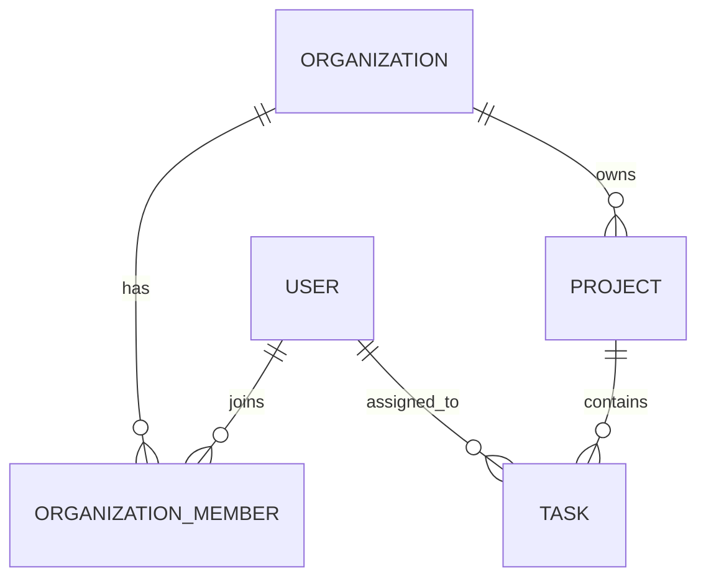

# Phase 0 数据模型

Phase 0 先落地支持主业务闭环的五个核心实体。认证、成员管理和任务业务在后续阶段实现，但表关系从第一天保持明确。

## 关系与约束

| 实体 | 关键约束 |
| --- | --- |
| User | email 唯一；保存 password hash，不保存明文密码 |
| Organization | 名称必填；删除前需处理所属项目和成员 |
| OrganizationMember | user 与 organization 组合唯一；role 属于成员关系 |
| Project | 必须属于一个组织；名称在组织内唯一；支持 archivedAt 归档 |
| Task | 必须属于项目；状态为 TODO、IN_PROGRESS 或 DONE；负责人可为空 |

数据库外键保证结构关系，组织成员资格和资源访问范围由后端 Service 在业务接口中校验。任务负责人必须是当前组织的有效成员，这个跨表业务约束不能只依赖前端。

## 当前刻意不包含

ProjectMember、评论、附件、通知、审计日志、权限表和自定义工作流会在对应阶段按真实需求加入。先保留五个实体能让迁移、关系和启动流程可验证，同时避免为未来功能提前建模。
