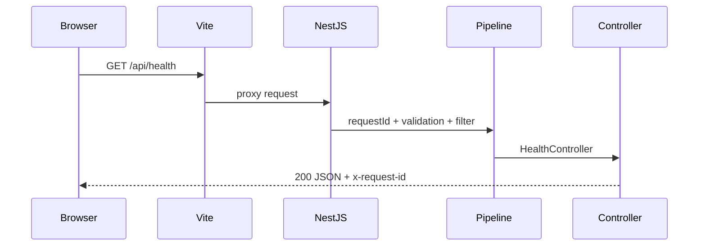

# Phase 0 启动与验证

这份文档说明如何从干净的工作区启动 MySQL、执行 Prisma 迁移、启动前后端，并验证一次请求的完整链路。

## 环境要求

- Node.js 22，版本由根目录 `.nvmrc` 约束
- pnpm 11
- Docker Desktop 或 OrbStack，Docker daemon 必须已经启动

检查命令：

```bash
node --version
pnpm --version
docker compose version
docker info
```

## 第一次安装

在仓库根目录执行：

```bash
corepack enable
pnpm install
cp .env.example .env
cp backend/.env.example backend/.env
cp frontend/.env.example frontend/.env
```

`.env` 只给 Docker Compose 使用，`backend/.env` 给 NestJS 和 Prisma 使用，`frontend/.env` 只包含可以暴露到浏览器的 API 地址。三个文件都已经被 Git 忽略；只提交对应的 `.env.example`。

## 启动数据库

```bash
pnpm db:up
docker compose ps
```

等待 `mysql` 的健康状态变为 `healthy`。查看数据库日志：

```bash
pnpm db:logs
```

停止数据库容器但保留数据：

```bash
pnpm db:down
```

如需清空本地数据库和 Docker volume，确认不再需要数据后执行：

```bash
docker compose down -v
```

## 数据库迁移

Phase 0 已提交初始 migration。启动 MySQL 后执行：

```bash
pnpm db:migrate
```

Compose 会在首次初始化 MySQL 时创建 `saas_project_manager_shadow`，供 Prisma 开发迁移使用。首次执行迁移会创建 Prisma migration history 和 Phase 0 的五张核心表。

它会在开发环境应用 migration，并在 Prisma schema 变化时创建新的 migration。只需要把生成的 `backend/prisma/migrations/` 提交 Git。

在已有 migration 的环境（例如 CI 或部署环境）使用：

```bash
pnpm db:deploy
```

不要在生产环境使用 `prisma db push`，也不要修改已经提交并执行过的 migration；新的数据库变化应创建新的 migration。

查看数据库：

```bash
pnpm db:studio
```

## 启动项目

同时启动前端和后端：

```bash
pnpm dev
```

也可以分别启动：

```bash
pnpm dev:backend
pnpm dev:frontend
```

访问：

| 地址 | 用途 |
| --- | --- |
| http://localhost:5173 | Vue 前端 |
| http://localhost:3000/api/health | 健康检查 API |
| http://localhost:3000/docs | Swagger UI |

开发环境中的 Vite 会把 `/api` 请求代理到 `http://localhost:3000`。如需修改 API 地址，编辑 `frontend/.env` 的 `VITE_API_BASE_URL`。

## 验证 Phase 0

### API 健康检查

```bash
curl -i http://localhost:3000/api/health
```

成功响应示例：

```json
{
  "status": "ok",
  "service": "backend",
  "timestamp": "2026-09-27T00:00:00.000Z",
  "requestId": "..."
}
```

响应头会包含同一个 `x-request-id`。后端终端日志也会记录该 ID，便于把浏览器请求和服务端日志对应起来。

### 错误格式

健康检查只接受 `GET`。例如：

```bash
curl -i -X POST http://localhost:3000/api/health
```

错误响应包含 `statusCode`、稳定的 `code`、用户可理解的 `message` 和 `requestId`，不会返回堆栈或数据库连接信息。

### 自动检查

```bash
pnpm lint
pnpm test
pnpm build
```

`pnpm test` 当前验证健康检查控制器的返回结构，不要求连接数据库；数据库迁移则由 `pnpm db:migrate` 单独验证。

## 请求链路



Phase 0 的健康检查不访问数据库，数据库链路由 Prisma migration 和后续业务接口验证。这样可以分别判断“应用是否启动”和“数据库是否可用”。

## 常见问题

### Docker daemon 未运行

如果看到 `Cannot connect to the Docker daemon`，启动 Docker Desktop 或 OrbStack 后再执行 `pnpm db:up`。命令行和 Compose 已安装并不代表后台服务正在运行。

### 3307 端口被占用

查看占用进程：

```bash
lsof -nP -iTCP:3307 -sTCP:LISTEN
```

停止冲突的 MySQL，或修改 `compose.yaml` 左侧端口并同步修改 `backend/.env` 中的连接地址。Compose 默认使用宿主机 `3307`，容器内部仍使用 `3306`，这样不会和开发机已有 MySQL 冲突。

### Prisma 连接失败

确认 MySQL 已经 `healthy`，再检查 `backend/.env` 的 `DATABASE_URL` 与根目录 `.env` 的账号、密码、数据库名一致。注意默认端口是宿主机 `3307`。修改 Compose 环境变量后，如果已有 volume，旧账号配置不会自动覆盖；需要重新初始化时执行 `docker compose down -v`。

## 当前限制与后续

- Phase 0 只提供健康检查和数据库骨架，没有注册、登录或业务 CRUD。
- MySQL 通过本地 Docker volume 持久化，尚未提供生产备份。
- 日志是开发环境的结构化基础版本，尚未接入集中式日志或指标系统。
- 下一阶段先实现账号、组织、项目和任务列表，并为每个能力新增 `docs/specs/` 中的 Feature Spec。
